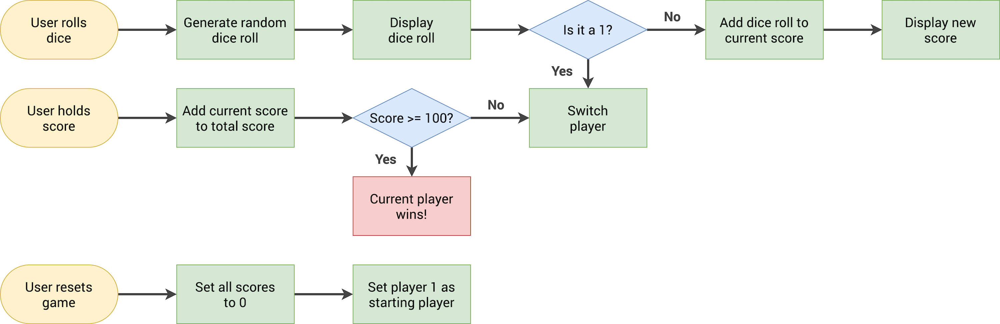

# Pig Game

A beautiful, interactive two-player dice game built for web browsers. Players take turns rolling a die to accumulate points, risking their current turn's score if they roll a 1. The first player to reach a total score of 50 or more wins the match!

---

## 🗺️ Game Workflow Diagram

The complete application logic, player-switching conditions, and victory states are mapped out in the flowchart below:



---

## 🛠️ Tech Stack

*   **Structure:** HTML5 (semantic layout components)
*   **Styling:** CSS3 (Featuring a smooth gradient background, glassmorphism backdrop filters, and custom transitions)
*   **Typography:** Nunito (Google Fonts)
*   **Logic Engine:** Vanilla JavaScript (ES6+ state management and DOM manipulation)

---

## ✨ Key Features

*   **Dynamic Turn Points:** Roll the dice multiple times to build your temporary turn score.
*   **Risk-and-Reward Rule:** Rolling a 1 instantly clears your current turn score and automatically switches the active turn to the other player.
*   **Secure Score Banking:** Clicking the "Hold" button locks in your temporary points, safely adding them to your total global score.
*   **Smart Turn Highlights:** Clean visual indicators instantly switch opacity and background shades to show exactly whose turn it is.
*   **Dynamic Victory State:** Automatically seals the board inputs once a player hits 50+ total points, applying a dark winning theme to the champion's card.
*   **Board Reset Engine:** A "New Game" system that instantly wipes all accumulated points, resets active player tracking back to Player 1, and hides the dice asset.

---

## 📂 File Structure

```text
├── index.html               # Game element framework and layout containers
├── style.css                # Visual presentation, glassmorphism design, and animations
├── script.js                # State management framework and button interaction handlers
├── pig-game-flowchart.png   # Game logic workflow diagram reference image
└── dice-*.png               # Dice graphic image assets used during active gameplay
